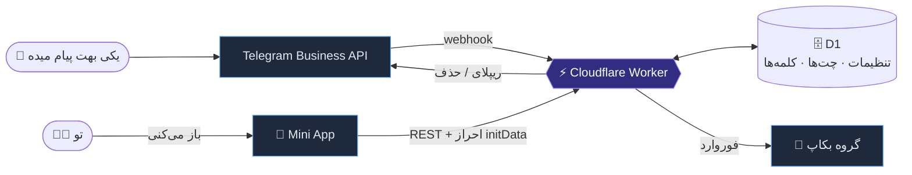
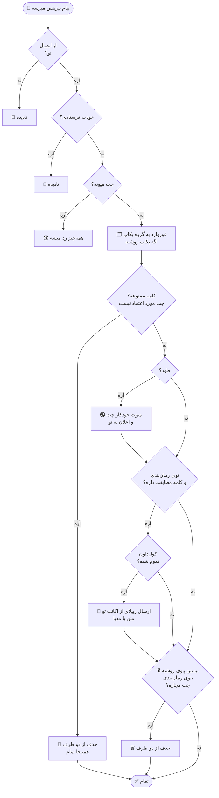
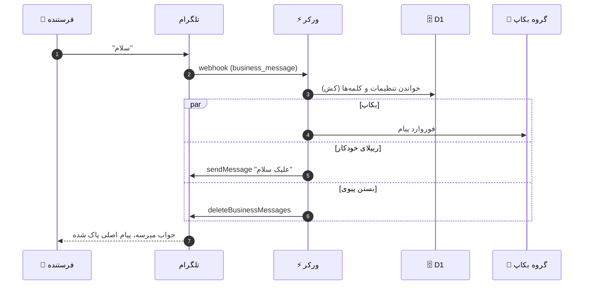
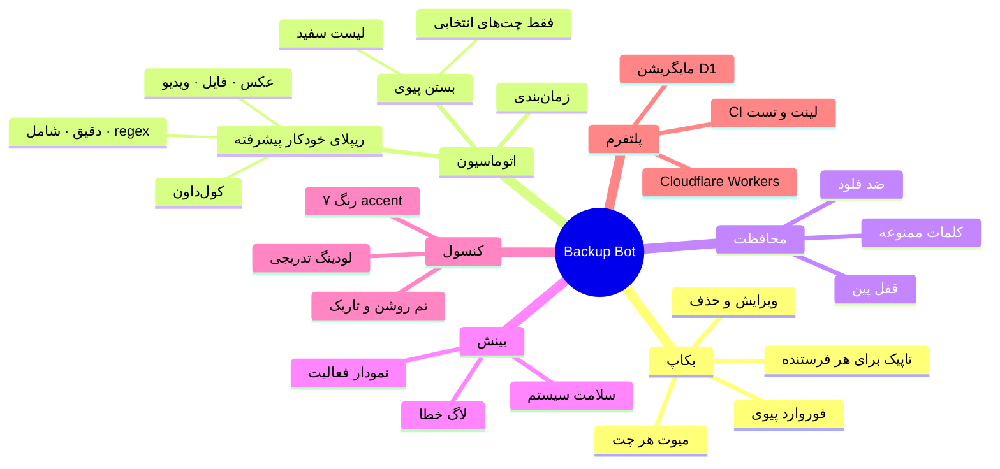
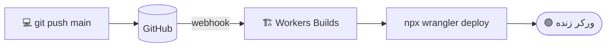
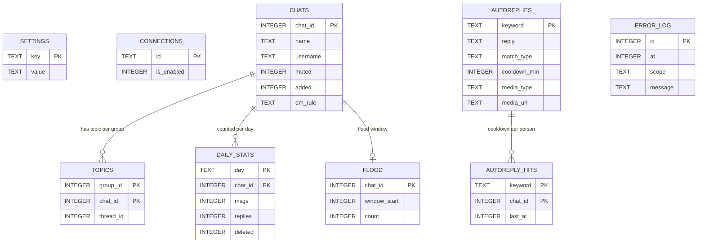

<a id="readme-top"></a>

<div align="center">


[English](README.md) · **فارسی**

[قابلیت‌ها](#-قابلیتها) · [پیش‌نمایش](#-پیشنمایش) · [نحوه کار](#-نحوه-کار) · [راه‌اندازی](#-راهاندازی-سریع) · [دیپلوی خودکار](#-دیپلوی-خودکار) · [دیتابیس](#-دیتابیس) · [سوالات متداول](#-سوالات-متداول)

</div>

---

<div dir="rtl">

## ✨ این پروژه چیه؟

یک **ربات خصوصی تلگرام بیزینس** که فقط برای صاحب اکانت کار می‌کنه. همه پیام‌های خصوصی دریافتی اکانتت رو بی‌سروصدا توی یه گروه بکاپ کپی می‌کنه و یه **کنسول Mini App** شیک بهت میده که از داخل خود تلگرام کنترلش کنی.

کل پروژه روی **Cloudflare Workers + D1** اجرا میشه. یعنی سرور نداره که مراقبش باشی و **هیچ‌وقت محتوای پیام‌ها رو ذخیره نمی‌کنه**. پیام‌ها مستقیم به گروهت فوروارد میشن و دیتابیس فقط تنظیمات، آیدی تاپیک‌ها و اسم چت‌ها رو نگه می‌داره.

> [!NOTE]
> همه‌چیز **فقط برای `OWNER_ID`** کار می‌کنه (توی `wrangler.toml` تنظیم میشه). هیچ‌کس دیگه‌ای نمی‌تونه از ربات یا کنسول استفاده کنه.

## 🚀 قابلیت‌ها

| | قابلیت | توضیح |
|---|---|---|
| 🗂️ | **بکاپ پیام‌ها** | هر پیام خصوصی دریافتی به گروه بکاپ فوروارد میشه (`/setgr`) |
| ✏️ | **ویرایش و حذف** | پیام ویرایش‌شده با برچسب دوباره ارسال میشه و برای پیام حذف‌شده اعلان میاد |
| 🧵 | **تاپیک برای هر فرستنده** | اختیاری: برای هر نفر یک تاپیک جدا، تا گروه مرتب بمونه |
| 🔒 | **بستن پیوی** | با یک کلید، پیام‌های خصوصی دریافتی **از دو طرف** بلافاصله پاک میشن |
| 🛡️ | **لیست سفید و حالت‌ها** | چت‌ها رو روی *هیچ‌وقت پاک نشه* بذار (خانواده، مشتری مهم) یا حالت رو بذار روی *فقط چت‌هایی که انتخاب می‌کنم* |
| 🕒 | **زمان‌بندی** | بستن پیوی و ریپلای خودکار فقط توی ساعت‌های دلخواه فعال باشن (بازه شبانه و تایم‌زون پشتیبانی میشه) |
| 💬 | **ریپلای خودکار پیشرفته** | تطبیق دقیق، *شامل کلمه* یا **regex**، **کول‌داون** برای هر نفر، و عکس/فایل/ویدیو |
| 🚫 | **محافظت از اسپم** | حذف پیام‌های دارای کلمه ممنوعه و میوت خودکار چتی که فلود می‌کنه |
| 🗑 | **حذف چت** | با یک ضربه چت از کنسول حذف میشه، تاپیکش (با همه پیام‌های داخلش) پاک میشه و ردیف‌هاش از دیتابیس میره؛ برای این که به سقف تعداد تاپیک تلگرام نخوری |
| 🧹 | **پاک‌سازی گروهی و خودکار** | چند چت رو انتخاب و یکجا حذف کن، یا بذار هر شب چت‌هایی که N روز ساکت بودن پاک بشن (چت‌های پین‌شده امنن). کارت سلامت تعداد تاپیک‌ها رو نشون میده و نزدیک سقف هشدار میده |
| 📌 | **سازمان‌دهی چت‌ها** | هر چت رو پین کن، برچسب بزن و یادداشت خصوصی بنویس؛ مرتب‌سازی بر اساس آخرین فعالیت، جدیدترین یا نام؛ فیلتر با برچسب |
| 🎯 | **ریپلای مخصوص چت یا ساعت** | یک قانون می‌تونه فقط برای یک چت باشه (VIP جواب متفاوت بگیره) و/یا فقط بین ساعت‌های مشخص |
| ↪️ | **ریپلای زنجیره‌ای** | اگه N دقیقه بعد از ریپلای خودکار هنوز جواب ندادی، ربات پیام دوم رو می‌فرسته. خودت جواب بدی لغو میشه |
| 🔐 | **قفل پین کنسول** | پین هش‌شده با PBKDF2 که سرور اعمالش می‌کنه، قفل موقت بعد از چند اشتباه، و قفل خودکار در پس‌زمینه |
| 📊 | **نمودار فعالیت** | پیام در روز (۷/۱۴/۳۰ روز)، ریپلای‌ها، حذف‌ها و فعال‌ترین چت‌ها. فقط شمارنده |
| 🩺 | **سلامت سیستم** | تاخیر دیتابیس، وضعیت webhook، اتصال، آخرین خطاها و نسخه دیپلوی‌شده |
| 🔇 | **میوت هر چت** | بکاپ رو برای چت‌های مشخص خاموش کن |
| ♾️ | **لودینگ تدریجی چت‌ها** | با اسکرول ۳۰ تا ۳۰ تا لود میشه، پس با هزاران چت هم سریع می‌مونه |
| 🌗 | **تم روشن / تاریک / سیستم** | انتخاب دستی تم که روی سرور ذخیره میشه |
| 🎨 | **۷ رنگ accent** | قرمز، سبز، زرد، بنفش، صورتی، آبی، نارنجی. فقط accent، نه بک‌گراند |
| 🫧 | **UI نرم و روان** | انیمیشن جابه‌جایی، کلیدهای فنری، شیت‌های لغزنده و توست. احترام به *reduced motion* |

## 📱 پیش‌نمایش

<div align="center">
<table>
<tr>
<td align="center" width="420">


<sub>رنگ accent بین هر ۷ پریست می‌چرخه</sub>

</td>
<td valign="top" dir="rtl">

**تب‌های کنسول**

- **Overview**: وضعیت، سلامت سیستم، نمودار فعالیت
- **Chats**: جستجو، میوت، قانون بستن پیوی برای هر چت، اسکرول بی‌نهایت
- **Account**: وضعیت اتصال و دسترسی‌های داده‌شده
- **Settings**: تم، قفل پین، بستن پیوی، زمان‌بندی، اسپم، ریپلای‌های خودکار

<br/>

**پالت رنگی**

🔴 قرمز &nbsp; 🟢 سبز &nbsp; 🟡 زرد &nbsp; 🟣 بنفش<br/>
🩷 صورتی &nbsp; 🔵 آبی &nbsp; 🟠 نارنجی

</td>
</tr>
</table>
</div>

## 🧠 نحوه کار

### معماری

</div>



<div dir="rtl">

### با هر پیام دریافتی چه اتفاقی میفته؟

</div>



<div dir="rtl">

### توالی پیام‌ها

</div>



<div dir="rtl">

### یه نگاه کلی

</div>



<div dir="rtl">

## ⚡ راه‌اندازی سریع

<details open>
<summary><b>تنظیم اولیه (PowerShell)</b></summary>

<div dir="ltr">

```powershell
npm install
npx wrangler login
npx wrangler d1 create business_bot        # database_id رو توی wrangler.toml بذار (اگه قبلاً داری رد شو)
npm run db:migrate                          # همه فایل‌های migrations/ رو به ترتیب اجرا می‌کنه
npx wrangler secret put BOT_TOKEN
npx wrangler secret put WEBHOOK_SECRET
npx wrangler deploy
.\set-webhook.ps1 -BotToken "<TOKEN>" -WorkerUrl "https://<worker>.workers.dev" -Secret "<WEBHOOK_SECRET>"
```

</div>

بعدش توی چت خصوصی با ربات `/start` بزن تا دکمه **Console** رو بگیری.

</details>

### اتصال اکانت بیزینس

1. تلگرام ← **Settings ← Business ← Chatbots** ← ربات رو اضافه کن.
2. دسترسی‌های لازم رو بده (**reply** برای ریپلای خودکار، **delete messages** برای بستن پیوی).
3. ربات رو توی گروه بکاپ اضافه کن و همونجا `/setgr` بزن.

### دستورها

| کجا | دستور | کارش |
|---|---|---|
| چت خصوصی | `/start` | دکمه Console رو باز می‌کنه |
| چت خصوصی | `/status` | وضعیت فعلی رو نشون میده |
| گروه بکاپ | `/setgr` | اون گروه رو مقصد بکاپ می‌کنه |

> [!IMPORTANT]
> **بستن پیوی به دسترسی «delete messages»** روی اتصال بیزینس نیاز داره و فقط توی بازه حذف ۴۸ ساعته تلگرام کار می‌کنه. اگه این دسترسی نباشه، ربات بهت هشدار میده و بی‌صدا شکست نمی‌خوره (حداکثر یک هشدار در دقیقه).

> [!WARNING]
> **چت‌های میوت‌شده کلاً رد میشن.** چت میوت‌شده نه بکاپ میشه، نه ریپلای خودکار می‌گیره و نه با بستن پیوی پاک میشه.

## 🔁 دیپلوی خودکار

این ریپو به **Cloudflare Workers Builds** وصله. با هر پوش روی `main`، پروژه بیلد و با `npx wrangler deploy` دیپلوی میشه. نیازی به فایل GitHub Actions نیست.

</div>



<div dir="rtl">

سکرت‌ها (`BOT_TOKEN` و `WEBHOOK_SECRET`) توی Cloudflare نگه‌داری میشن (متغیرهای بیلد با تیک *Encrypt*) و هیچ‌وقت توی این ریپو نیستن.

## 🗄️ دیتابیس

اسکیمای دیتابیس توی پوشه [`migrations/`](migrations) به‌صورت فایل‌های SQL شماره‌دار نگه‌داری میشه (مایگریشن‌های native خود Wrangler برای D1). Wrangler توی جدول `d1_migrations` ثبت می‌کنه چی قبلاً اجرا شده، پس اجرای دوباره همیشه امنه.

</div>



<div dir="rtl">

> [!NOTE]
> **محتوای پیام‌ها هیچ‌وقت ذخیره نمیشه.** جدول `daily_stats` فقط عدد نگه می‌داره، `error_log` فقط توضیح خطاها (۵۰ تای آخر) و `autoreply_hits` و `flood` فقط آیدی و زمان.

| دستور | کاربرد |
|---|---|
| `npm run db:migrate` | اجرای مایگریشن‌های جدید روی دیتابیس **اصلی** |
| `npm run db:migrate:local` | اجرا روی دیتابیس لوکال برای تست |

برای تغییر اسکیما، فایل `migrations/0003_something.sql` رو بساز و `npm run db:migrate` رو بزن. مایگریشنی که یک بار اجرا شده رو هیچ‌وقت ویرایش نکن.

> [!IMPORTANT]
> مایگریشن‌ها عمداً **موقع دیپلوی خودکار اجرا نمیشن**. چون فقط چیز اضافه می‌کنن، اول **`npm run db:migrate` رو بزن و بعد دیپلوی کن**: کد جدید به جدول‌ها و ستون‌های جدید نیاز داره.

## 🧪 تست و CI

| دستور | کارش |
|---|---|
| `npm run lint` | ESLint روی `src/`، `public/`، `test/` و `scripts/` |
| `npm test` | تست واحد برای منطق تصمیم‌گیری (تطبیق ریپلای، زمان‌بندی، قوانین بستن پیوی، اسپم، پین، رمزنگاری) |
| `npm run check` | لینت و تست واحد (همونی که CI اجرا می‌کنه) |
| `npm run dev:test` و بعد `npm run smoke` | تست یکپارچه: ورکر + D1 لوکال، اجرای همه مایگریشن‌ها، وبهوک‌های تلگرام جعلی و تست همه مسیرهای API (۹۱ چک) |
| `npm run smoke:ui` | خود Mini App واقعی رو توی jsdom روی همون ورکر اجرا می‌کنه: همه تب‌ها، ویرایشگر ریپلای خودکار و جریان قفل پین (۴۲ چک) |

یه workflow اختیاری برای GitHub Actions توی [`docs/ci.yml.example`](docs/ci.yml.example) هست. کپیش کن به `.github/workflows/ci.yml` تا با هر پوش و پول‌ریکوئست `npm run check` اجرا بشه (فقط چک می‌کنه و هیچ‌وقت دیپلوی نمی‌کنه).

> [!TIP]
> توی Cloudflare بخش **Workers Builds ← Build command** رو بذار `npm run check`. اینطوری اگه تست یا لینت خطا بده، دیپلوی متوقف میشه و ورکر خراب روی سرور نمیره.

## 🧰 تکنولوژی‌ها

| لایه | انتخاب |
|---|---|
| اجرا | Cloudflare Workers |
| دیتابیس | Cloudflare D1 (SQLite) |
| فرانت‌اند | Mini App با Vanilla JS، بدون build، توکن‌های سبک shadcn/ui |
| احراز هویت | `initData` تلگرام، فقط مالک |
| CI/CD | Cloudflare Workers Builds (دیپلوی)، GitHub Actions اختیاری (لینت و تست) |

<details>
<summary><b>📁 ساختار ریپو</b></summary>

<div dir="ltr">

```text
.
├── src/
│   ├── index.js        # ورودی webhook و دستورها
│   ├── backup.js       # فوروارد، ریپلای خودکار، بستن پیوی، اسپم، فلود، آمار
│   ├── rules.js        # منطق تصمیم‌گیری خالص (تست‌شده)
│   ├── api.js          # REST API مینی‌اپ و قفل پین
│   └── lib.js          # ابزارهای تلگرام، رمزنگاری و فرمت‌دهی
├── public/             # Mini App (index.html, app.js, app.css)
├── assets/             # تصاویر README (SVG انیمیشنی)
├── migrations/         # مایگریشن‌های D1 (0001 تا 0010)
├── test/               # تست‌های واحد (node --test)
├── scripts/            # تست یکپارچه (smoke)
├── db-legacy/          # فایل‌های قدیمی اسکیما، فقط برای مرجع
├── docs/               # نمونه workflow اختیاری CI
├── wrangler.toml
└── set-webhook.ps1
```

</div>

</details>

## ❓ سوالات متداول

<details>
<summary><b>پیام‌هام ذخیره میشن؟</b></summary>

نه. پیام‌ها به گروهت فوروارد میشن و هیچ‌وقت توی دیتابیس نوشته نمیشن. D1 فقط تنظیمات، اتصال‌ها، آیدی تاپیک‌ها و اسم چت‌ها رو نگه می‌داره.

</details>

<details>
<summary><b>ریپلای خودکار دقیقاً چطوری تطبیق میده؟</b></summary>

سه حالت برای هر قانون هست:

- **کلمه دقیق**: **کل پیام** (بدون فاصله‌های ابتدا و انتها و بدون حساسیت به بزرگی/کوچکی حروف) باید دقیقاً برابر کلمه باشه. اگه `سلام` ← `علیک سلام` تنظیم کنی، پیام `سلام` فعالش می‌کنه ولی `سلام چطوری` نه.
- **شامل کلمه**: کلمه می‌تونه هرجای پیام باشه.
- **Regex**: یه الگوی بدون حساسیت به حروف (حداکثر ۱۰۰ کاراکتر). الگوهایی با quantifier تودرتو یا back-reference رد میشن تا جلوی بک‌ترکینگ فاجعه‌بار گرفته بشه.

اول قانون‌های دقیق چک میشن، بعد «شامل»، بعد regex. **کول‌داون** (دقیقه، برای هر نفر) جلوی اینو می‌گیره که یه نفر زود به زود یه کلمه رو تکرار کنه. ریپلای مدیا یه لینک مستقیم `https` می‌گیره و متن ریپلای میشه کپشن.

</details>

<details>
<summary><b>پین کنسول رو فراموش کردم.</b></summary>

پین فقط یه قفل روی کنسوله، پس می‌تونی از دیتابیس حذفش کنی:

</div>

```powershell
npx wrangler d1 execute business_bot --remote --command "DELETE FROM settings WHERE key IN ('pin_hash','pin_fail','pin_lock_until')"
```

<div dir="rtl">

</details>

<details>
<summary><b>چرا بستن پیوی گاهی شکست می‌خوره؟</b></summary>

تلگرام فقط با دسترسی **delete messages** و توی بازه حذف عادی خودش اجازه حذف پیام بیزینس رو میده. خطاها توی **سلامت سیستم ← آخرین خطاها** میان و ربات هم (با محدودیت زمانی) بهت پیام میده.

</details>

<details>
<summary><b>تغییر تنظیمات دیر اعمال میشه.</b></summary>

ورکر برای سرعت، تنظیمات رو کوتاه‌مدت کش می‌کنه. تغییرات حدود ۱۵ ثانیه‌ای اعمال میشن.

</details>

<details>
<summary><b>اینکه <code>OWNER_ID</code> و <code>database_id</code> توی <code>wrangler.toml</code> هستن امنه؟</b></summary>

آره. این‌ها شناسه‌ان نه رمز. سکرت‌های واقعی (`BOT_TOKEN` و `WEBHOOK_SECRET`) به‌صورت Cloudflare secret نگه‌داری میشن.

</details>

---

<div align="center">

ساخته‌شده با ☕ توسط [@imhamiddev](https://github.com/imhamiddev)

<a href="#readme-top">↑ بازگشت به بالا</a>

</div>

</div>
