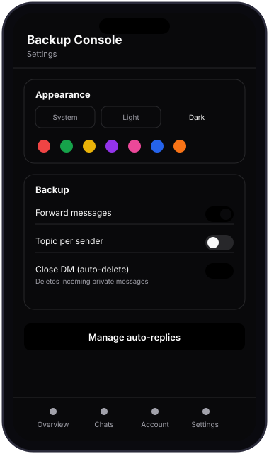
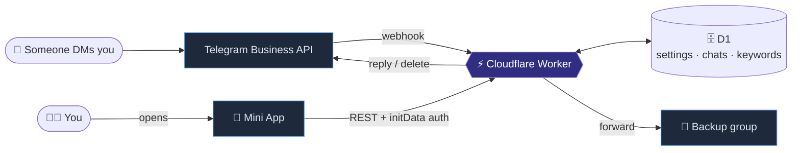
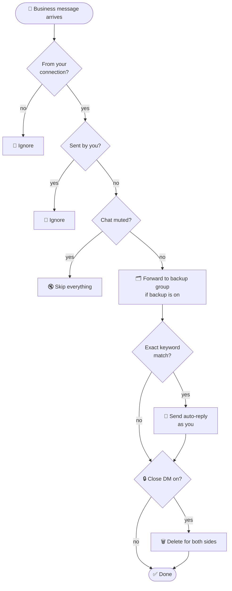
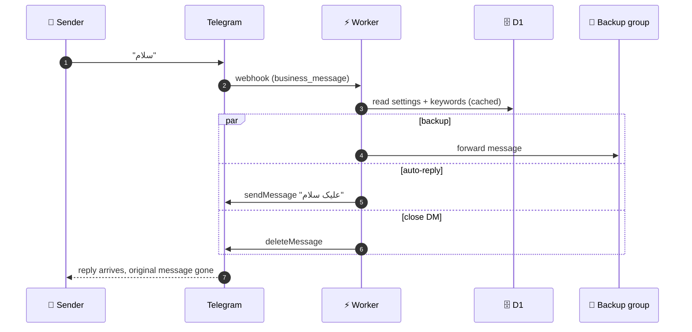
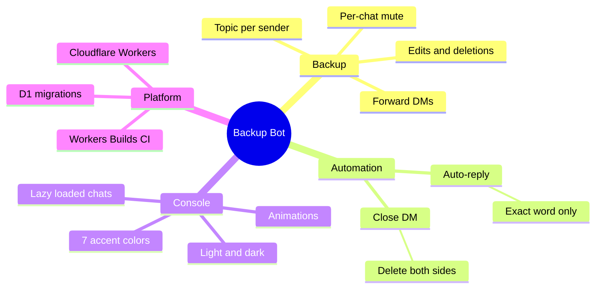
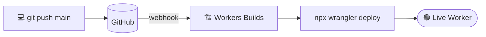
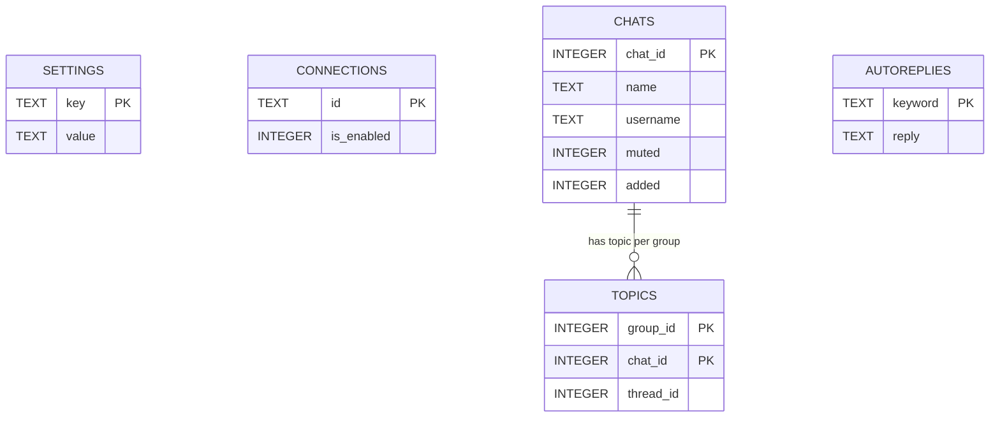

<a id="readme-top"></a>

<div align="center">


<a href="https://github.com/imhamiddev/Telegram-account-manager">
  
</a>

<br/>


**English** · [فارسی](README.fa.md)

[Features](#-features) · [Preview](#-preview) · [How it works](#-how-it-works) · [Quick start](#-quick-start) · [Auto-deploy](#-auto-deploy) · [Database](#-database) · [FAQ](#-faq)

</div>

---

## ✨ What is this?

A **private, single-owner Telegram Business bot** that quietly mirrors every incoming private message of your account into a backup group, and gives you a slick **Mini App console** to control it from inside Telegram.

It runs entirely on **Cloudflare Workers + D1**. It is serverless, has no servers to babysit, and **never stores message content**. Messages are forwarded straight to your group; the database only keeps settings, topic ids and chat names.

> [!NOTE]
> Everything works **only for `OWNER_ID`** (set in `wrangler.toml`). Nobody else can use the bot or open the console.

## 🚀 Features

| | Feature | Details |
|---|---|---|
| 🗂️ | **Message backup** | Every incoming DM is forwarded to your backup group (`/setgr`) |
| ✏️ | **Edits & deletions** | Edited messages are re-sent with a label; deleted messages produce a notice |
| 🧵 | **Topic per sender** | Optional: one forum topic per person, so the group stays organised |
| 🔒 | **Close DM** | One switch: every incoming private message is deleted for **both sides**, instantly |
| 💬 | **Auto-reply** | Set a keyword and a reply. If someone sends **exactly** that word, the bot answers from your account |
| 🔇 | **Per-chat mute** | Turn backup off for individual chats |
| ♾️ | **Lazy-loaded chats** | The chat list loads 30 at a time as you scroll, so it stays fast with thousands of chats |
| 🌗 | **Light / Dark / System** | Manual theme override, saved on the server |
| 🎨 | **7 accent colors** | Red, green, yellow, purple, pink, blue, orange. Accent only, never the background |
| 🫧 | **Smooth UI** | Animated view transitions, springy switches, press feedback, sliding sheets, toasts. Honors *reduced motion* |

## 📱 Preview

<div align="center">
<table>
<tr>
<td align="center" width="420">



<sub>The accent color cycles through all 7 presets</sub>

</td>
<td valign="top">

**Console tabs**

- **Overview**: live status, group, alerts
- **Chats**: search, mute/unmute, infinite scroll
- **Account**: connection status and granted permissions
- **Settings**: theme, accent, Close DM, topics, auto-replies

<br/>

**Accent palette**

🔴 Red &nbsp; 🟢 Green &nbsp; 🟡 Yellow &nbsp; 🟣 Purple<br/>
🩷 Pink &nbsp; 🔵 Blue &nbsp; 🟠 Orange

</td>
</tr>
</table>
</div>

## 🧠 How it works

### Architecture



### What happens to every incoming message



### Message sequence



### Features at a glance



## ⚡ Quick start

<details open>
<summary><b>One-time setup (PowerShell)</b></summary>

```powershell
npm install
npx wrangler login
npx wrangler d1 create business_bot        # put database_id in wrangler.toml (skip if you already have it)
npm run db:migrate                          # applies everything in migrations/, in order
npx wrangler secret put BOT_TOKEN
npx wrangler secret put WEBHOOK_SECRET
npx wrangler deploy
.\set-webhook.ps1 -BotToken "<TOKEN>" -WorkerUrl "https://<worker>.workers.dev" -Secret "<WEBHOOK_SECRET>"
```

Then send `/start` to the bot in a private chat to get the **Console** button.

</details>

### Connect your Business account

1. Telegram → **Settings → Business → Chatbots** → add your bot.
2. Grant it the permissions you need (**reply** for auto-reply, **delete messages** for Close DM).
3. Add the bot to your backup group and send `/setgr` there.

### Commands

| Where | Command | What it does |
|---|---|---|
| Private chat | `/start` | Opens the Console button |
| Private chat | `/status` | Shows current status |
| Backup group | `/setgr` | Sets that group as the backup destination |

> [!IMPORTANT]
> **Close DM needs the "delete messages" permission** on the Business connection, and only works inside Telegram's normal 48-hour delete window. If it is missing, the bot warns you instead of failing silently (at most one warning per minute).

> [!WARNING]
> **Muted chats are skipped entirely.** A muted chat is not backed up, not auto-replied and not deleted by Close DM.

## 🔁 Auto-deploy

This repo is connected to **Cloudflare Workers Builds**. Every push to `main` is built and deployed with `npx wrangler deploy`. No GitHub Actions file is needed.



Secrets (`BOT_TOKEN`, `WEBHOOK_SECRET`) live in Cloudflare (build variables, marked *Encrypt*), never in this repo.

## 🗄️ Database

Schema lives in [`migrations/`](migrations) as numbered SQL files (Wrangler native D1 migrations). Wrangler tracks what already ran in a `d1_migrations` table, so re-running is always safe.



| Command | Purpose |
|---|---|
| `npm run db:migrate` | Apply new migrations to the **live** database |
| `npm run db:migrate:local` | Apply to a local dev database |

To change the schema, add `migrations/0003_something.sql` and run `npm run db:migrate`. Never edit a migration that has already been applied.

> [!NOTE]
> Migrations are intentionally **not** run automatically on deploy. A schema change against real data should be a deliberate action.

## 🧰 Tech stack

| Layer | Choice |
|---|---|
| Runtime | Cloudflare Workers |
| Database | Cloudflare D1 (SQLite) |
| Frontend | Vanilla JS Mini App, no build step, shadcn/ui-style tokens |
| Auth | Telegram `initData`, owner only |
| CI/CD | Cloudflare Workers Builds |

<details>
<summary><b>📁 Repository layout</b></summary>

```text
.
├── src/
│   ├── index.js        # webhook entry + commands
│   ├── backup.js       # forwarding, auto-reply, Close DM
│   ├── api.js          # Mini App REST API
│   └── lib.js          # Telegram helpers, formatting
├── public/             # Mini App (index.html, app.js, app.css)
├── assets/             # README visuals (animated SVGs)
├── migrations/         # D1 migrations (0001, 0002, ...)
├── db-legacy/          # old hand-run schema files, reference only
├── wrangler.toml
└── set-webhook.ps1
```

</details>

## ❓ FAQ

<details>
<summary><b>Does it store my messages?</b></summary>

No. Messages are forwarded to your group and never written to the database. D1 holds only settings, connections, topic ids and chat names.

</details>

<details>
<summary><b>How exactly does auto-reply match?</b></summary>

The **whole message**, trimmed and case-insensitive, must equal a configured keyword. If you set `سلام` → `علیک سلام`, then `سلام` triggers it, but `سلام چطوری` does not.

</details>

<details>
<summary><b>Settings changes feel delayed.</b></summary>

The Worker caches settings briefly for speed. Changes apply within about 15 seconds.

</details>

<details>
<summary><b>Is it safe that <code>OWNER_ID</code> and <code>database_id</code> are in <code>wrangler.toml</code>?</b></summary>

Yes. They are identifiers, not credentials. Real secrets (`BOT_TOKEN`, `WEBHOOK_SECRET`) are stored as Cloudflare secrets.

</details>

---

<div align="center">

Made with ☕ by [@imhamiddev](https://github.com/imhamiddev)

<a href="#readme-top">↑ back to top</a>

</div>
